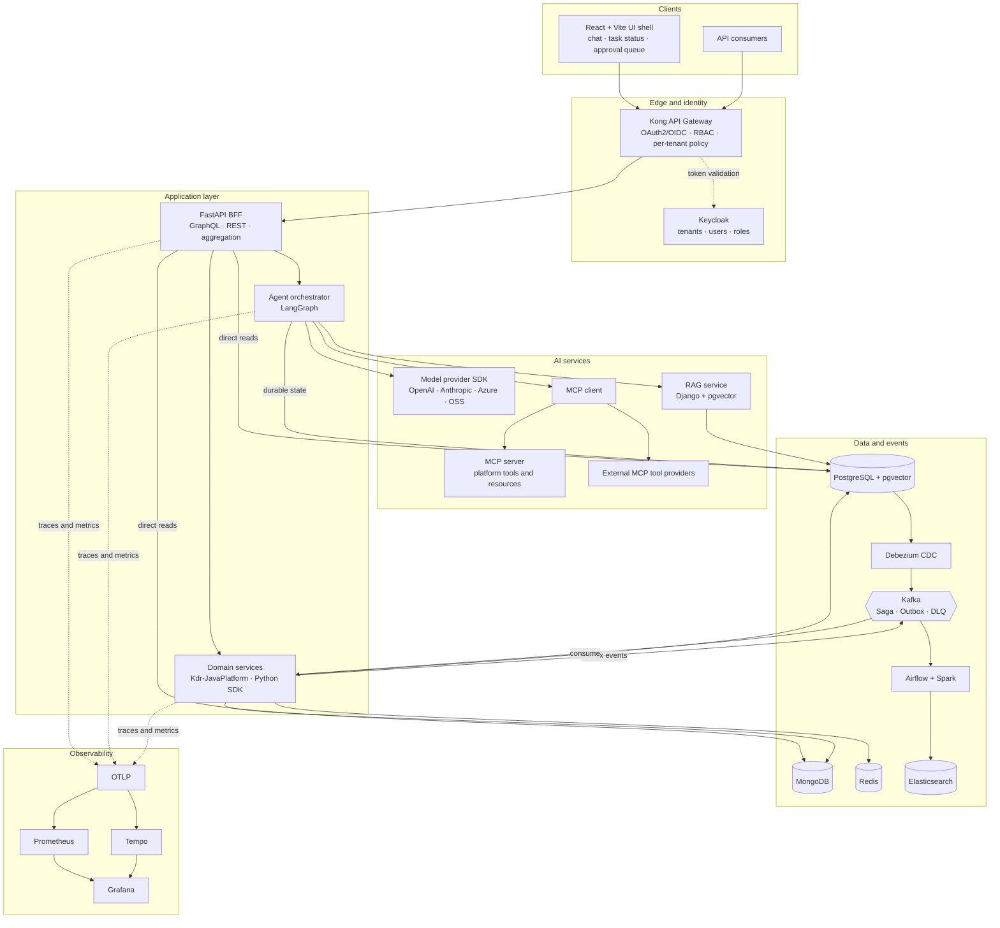
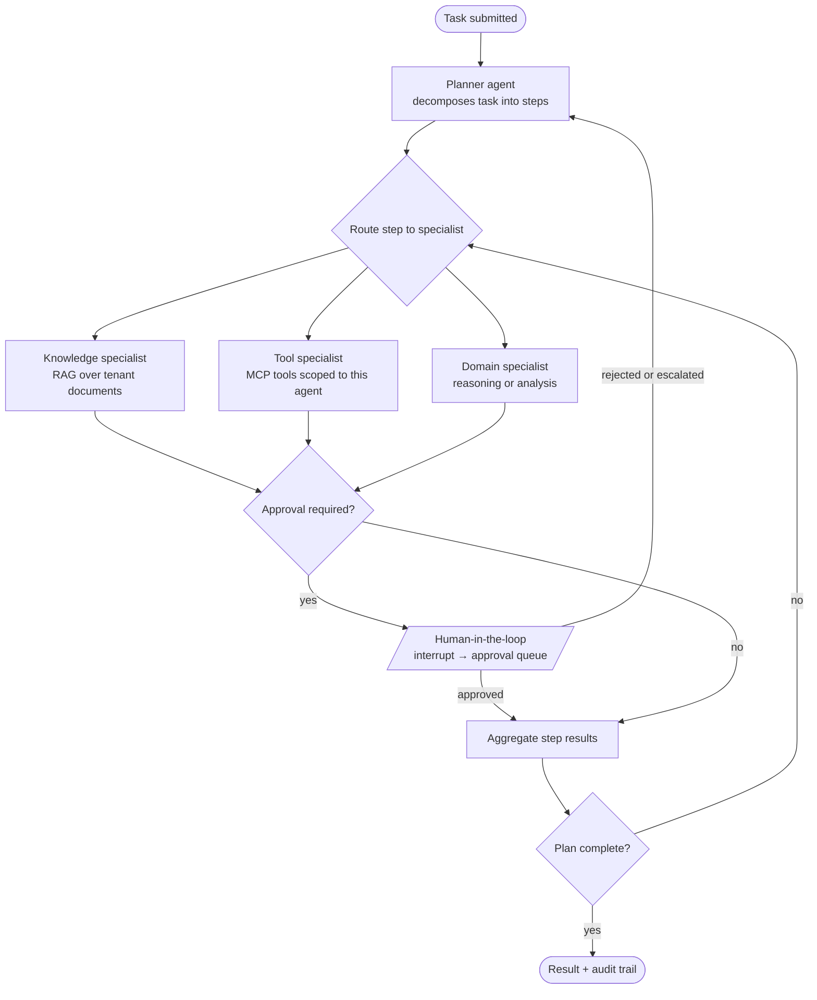
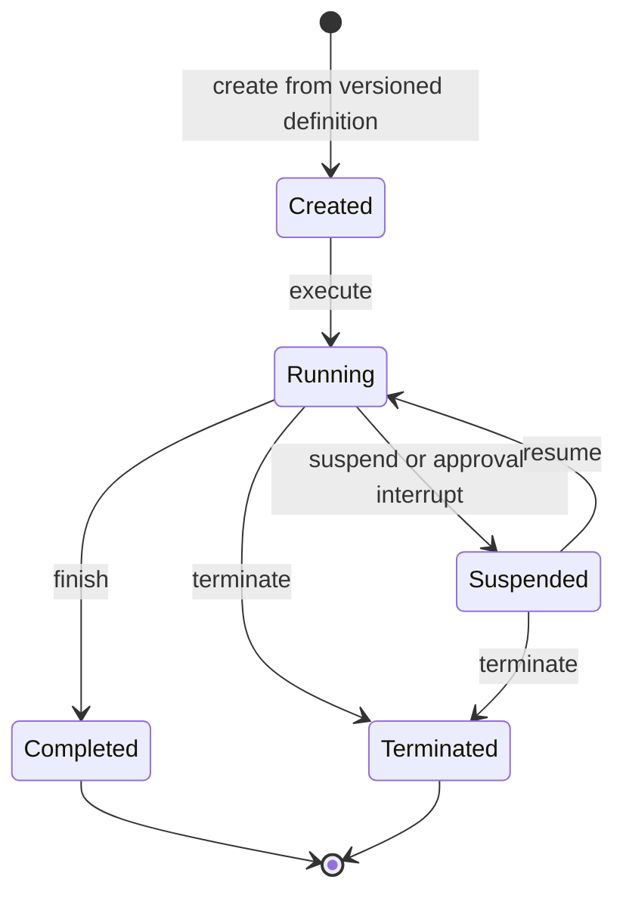
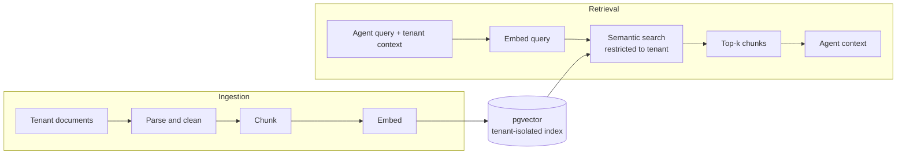
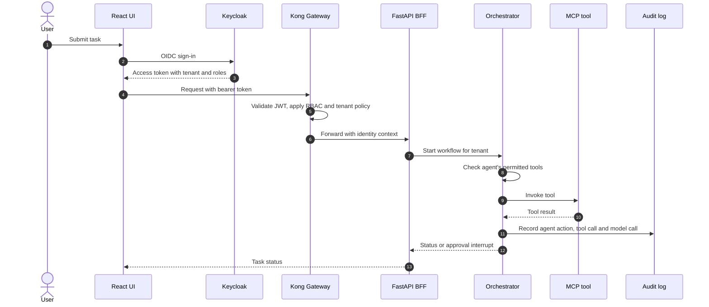
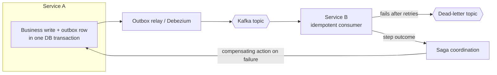
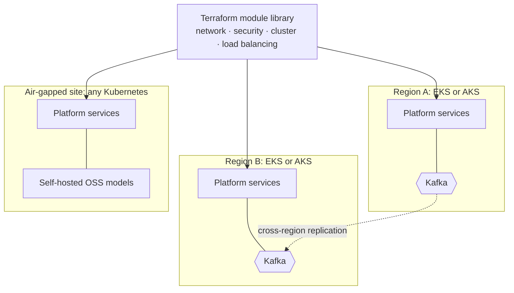
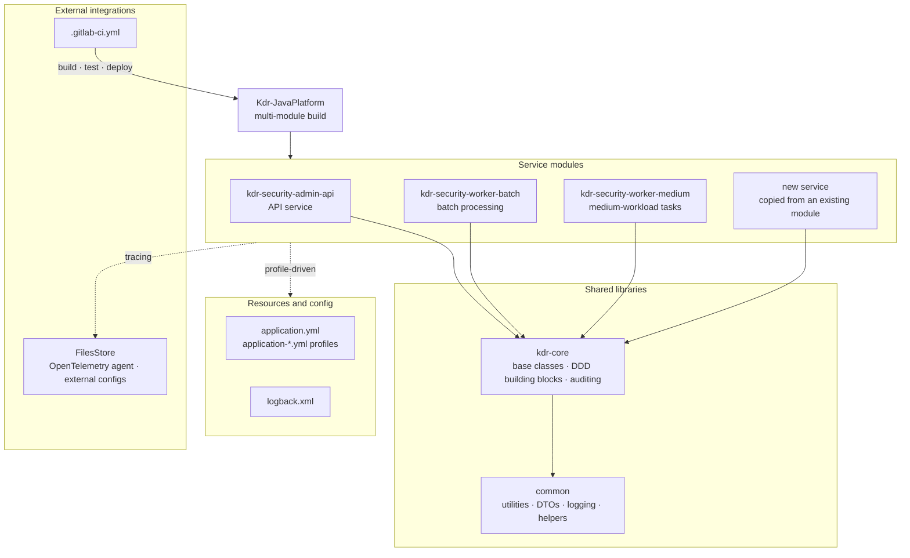

# Agentic Enterprise Platform

**A multi-tenant, air-gap-capable platform for building, running and governing AI agents, plus the Java and Python foundations that the rest of the platform runs on.**

Designed and built by **Dipti Murkar**, platform engineer (19+ years in distributed systems, cloud infrastructure and developer platforms).


> **This is a showcase repository.** It contains architecture documentation, diagrams and screenshots only, and no production code. The source lives in a private repository and is **available for review on request** (see [Contact](#contact)).

---

## Contents

- [Overview](#overview)
- [Project status](#project-status)
- [Architecture](#architecture)
  - [System overview](#system-overview)
  - [Multi-agent orchestration](#multi-agent-orchestration)
  - [Agent lifecycle](#agent-lifecycle)
  - [RAG pipeline](#rag-pipeline)
  - [Request flow and security](#request-flow-and-security)
  - [Event-driven backbone](#event-driven-backbone)
  - [Deployment topology](#deployment-topology)
- [Kdr-JavaPlatform: the Java service foundation](#kdr-javaplatform-the-java-service-foundation)
- [Features](#features)
- [Tech stack](#tech-stack)
- [Design decisions](#design-decisions)
- [Screenshots and demo](#screenshots-and-demo)
- [Contact](#contact)

---

## Overview

The platform lets an organization define multi-step AI workflows in which a **planner agent** breaks a task into steps and hands them to **specialist agents**. The specialists use tools exposed through **MCP**, draw on tenant-scoped knowledge through a **RAG** pipeline, and pause for **human approval** at defined checkpoints. Every action runs under per-tenant identity, policy and audit.

Around the agent layer sits a general-purpose distributed application platform: reusable Java and Python SDKs, a BFF layer, an API gateway with central identity, Kafka-based event patterns, data pipelines, and observability. Domain services and AI services are built and run the same way.

### Design goals

| Goal | What it means in practice |
|---|---|
| **Multi-tenant by default** | Tenant context flows from the identity token through gateway, BFF, agents, tools and knowledge stores |
| **Air-gap capable** | Runs with no outbound internet; self-hosted OSS models sit behind the same provider SDK as hosted ones |
| **Multi-region** | Stateless services per region; Kafka clusters replicated across regions |
| **Model-agnostic** | Model provider chosen per workflow step, not hard-coded per application |
| **Governed** | RBAC on who can invoke which models, tools and data; every agent action, tool call and model call audited |
| **Cloud-portable** | Same platform on AWS (EKS), Azure (AKS) or on-prem Kubernetes, provisioned by Terraform |

---

## Project status

Independent project, January 2024 to present. Core capabilities are implemented and operational.

| Area | Status |
|---|---|
| Multi-agent orchestration (LangGraph), agent lifecycle, durable state | ✅ Implemented |
| RAG pipeline (ingestion → retrieval, tenant isolation) | ✅ Implemented |
| MCP server and MCP client | ✅ Implemented |
| Model provider SDKs (OpenAI, Anthropic, Azure, OSS) | ✅ Implemented |
| Java (Kdr-JavaPlatform) and Python BFF SDKs | ✅ Implemented |
| FastAPI BFF, Kong gateway, Keycloak OAuth2/OIDC, RBAC | ✅ Implemented |
| Kafka components (Saga, Outbox, DLQ, idempotency) | ✅ Implemented |
| Observability (Prometheus, Grafana, Tempo, OTLP) | ✅ Implemented |
| Airflow + Spark batch and CDC pipelines | ✅ Implemented |
| Terraform modules for EKS / AKS | ✅ Implemented |
| Administrative UI integration | 🚧 In progress |
| Configurable workflows | 🚧 In progress |
| Reusable task-specific agent templates | 🚧 In progress |

---

## Architecture

### System overview



### Multi-agent orchestration

A planner decomposes the task; specialist agents execute steps with tools and knowledge scoped to their role and tenant; human review is a first-class node in the graph rather than a bolt-on.



### Agent lifecycle

Agent definitions are versioned; execution state is persisted durably per tenant, so a run can be suspended (by an operator or a human-approval interrupt) and resumed later.



### RAG pipeline



### Request flow and security



### Event-driven backbone

Reusable Kafka components give every service the same guarantees: no dual writes, safe redelivery, and a place for poison messages to go.



### Deployment topology



---

## Kdr-JavaPlatform: the Java service foundation

Kdr-JavaPlatform is the Java/Spring Boot foundation that domain services in the platform are built on. Its job is to make a new service mostly a matter of writing domain logic: security, logging, auditing, messaging, configuration and observability come with it.

**Module layout** (one multi-module build, one CI pipeline):

```text
Kdr-JavaPlatform/
├── kdr-core/                     # Shared base classes and core libraries
├── common/                       # Utilities, DTOs, logging, helpers
├── kdr-security-admin-api/       # Security Admin API service
├── kdr-security-worker-batch/    # Worker service for batch processing
├── kdr-security-worker-medium/   # Worker service for medium-workload tasks
├── resources/                    # application.yml, application-*.yml profiles, logback.xml
├── FilesStore/                   # External files, agents and configs (e.g. OpenTelemetry agent)
├── .gitlab-ci.yml                # CI/CD pipeline
└── root build file               # Builds all modules together
```



**What it provides**

- **Module-per-service layout.** `kdr-security-admin-api`, `kdr-security-worker-batch` and `kdr-security-worker-medium` follow one naming and folder convention, with API and worker roles split by workload. A new service starts as a copy of an existing module and inherits every shared library and configuration pattern on day one.
- **Two shared layers.** `kdr-core` holds base classes and core libraries; `common` holds utilities, DTOs, logging and helpers. Services depend on both and add only domain logic.
- **Domain-driven design.** Entities carry their own business rules; base entities and DTOs remove boilerplate, and shared utilities handle repetitive work such as carrying audit information between layers.
- **Shared core libraries.** Auditing, structured logging and DTO/entity transformation live in one place, so all services log, audit and map data the same way.
- **Profile-driven configuration.** Behavior and dependencies are defined centrally in `resources/` (`application.yml`, `application-*.yml`, `logback.xml`), so the same build moves between dev, test and prod without code changes.
- **Kafka built in.** Batch and real-time message handling, selected by profile.
- **Observability by default.** The OpenTelemetry agent ships in `FilesStore/` and is attached through JVM parameters, so every service gets distributed tracing and structured logs without code changes.
- **One build, one pipeline.** A root build compiles all modules together and `.gitlab-ci.yml` runs CI/CD for the whole platform.

**Why it matters:** teams spend their time on domain logic rather than plumbing, services stay consistent with each other, and engineers can move between modules without relearning conventions. The same approach is mirrored for Python services in the Python BFF SDK.

---

## Features

**Agents and orchestration**
- Stateful, graph-based workflows in LangGraph with branching, conditional routing and multi-agent collaboration
- Planner agent that decomposes tasks across specialist agents
- Full lifecycle control: create, execute, suspend, resume, terminate
- Versioned agent definitions and durable state, isolated per tenant
- Human-in-the-loop interrupts: agents pause mid-run, surface a decision to reviewers, and resume, with configurable escalation policies

**Models and tools**
- pip-installable Python SDKs abstracting OpenAI, Anthropic, Azure OpenAI and OSS models, with the model configurable per workflow step
- MCP server exposing platform tools and resources to agents
- MCP client consuming external tool providers through the same interface

**Knowledge (RAG)**
- End-to-end pipeline in Django and pgvector: ingestion, chunking, embedding, indexing and semantic retrieval
- Per-tenant knowledge isolation

**Security and governance**
- Keycloak OAuth2/OIDC and RBAC controlling which users, agents and tenants can invoke which models, tools and data sources
- Tool access scoped per agent and per tenant to prevent privilege escalation
- Audit log of every agent action, tool call and model interaction
- Kong gateway enforcing authentication, RBAC and per-tenant policy at the edge

**Application platform**
- Kdr-JavaPlatform (Java/Spring Boot) and a Python BFF SDK standardizing service structure, request aggregation, routing and auth propagation
- FastAPI BFF serving GraphQL, REST and direct reads from PostgreSQL and MongoDB, decoupling the UI from orchestration and business logic
- React + Vite UI shell with shared auth, tenant context, and agent components (chat, task status, approval queue)

**Data, events and operations**
- Reusable Kafka components: Saga, Outbox, dead-letter queues, idempotent consumers, multi-region clusters
- Polyglot persistence: PostgreSQL, MongoDB, Redis, Elasticsearch
- Airflow + Spark batch and CDC (Debezium) pipelines for real-time data sync
- Pluggable observability: OpenTelemetry/OTLP, Prometheus, Grafana, Tempo
- Terraform modules for AWS (EKS) and Azure (AKS)

---

## Tech stack

| Layer | Technologies |
|---|---|
| Agents and AI | LangGraph, MCP (server and client), RAG, pgvector, OpenAI / Anthropic / Azure OpenAI / OSS models |
| Backend | Python (FastAPI, Django), Java (Spring Boot, Kdr-JavaPlatform) |
| Frontend | React, Vite, Tauri |
| API and identity | Kong API Gateway, Keycloak, OAuth2, OIDC, JWT, RBAC, GraphQL, REST |
| Messaging | Kafka, Debezium (CDC) |
| Data | PostgreSQL, MongoDB, Redis, Elasticsearch, Airflow, Spark |
| Observability | OpenTelemetry (OTLP), Prometheus, Grafana, Tempo |
| Infrastructure | Docker, Kubernetes (EKS, AKS), Terraform, AWS, Azure |
| Build and CI/CD | Multi-module Java build, GitLab CI, Logback |

---

## Design decisions

Short records of the main choices and what they cost.

**1. LangGraph for orchestration**
*Why:* agent workflows need explicit state, branching, checkpoints and the ability to pause and resume, and a graph model makes those visible and testable. Human approval becomes a node in the graph.
*Trade-off:* more upfront structure than a free-form agent loop.

**2. pgvector instead of a separate vector database**
*Why:* one fewer system to run, secure and replicate, which matters most in air-gapped installs. Embeddings live next to the relational data they describe, under the same tenant isolation and backup story.
*Trade-off:* at very large scale a dedicated vector store may outperform it; the retrieval interface keeps that swap possible.

**3. MCP as the tool integration layer**
*Why:* one standard contract for both the platform's own tools and external tool providers. Agents don't care where a tool lives, and access control applies uniformly.
*Trade-off:* an extra protocol hop compared with direct function calls.

**4. A model provider SDK with per-step model selection**
*Why:* tenants differ in which providers they're allowed to use, and air-gapped sites can only use self-hosted models. Choosing the model per step also lets cheap models handle routine steps while stronger models handle planning.
*Trade-off:* the abstraction has to track provider differences in features such as tool calling and streaming.

**5. A BFF between the UI and everything else**
*Why:* the UI talks to one stable API while orchestration and business services evolve behind it, so services can be migrated incrementally without breaking clients.
*Trade-off:* another service to own; kept thin on purpose.

**6. Kong and Keycloak for identity and policy**
*Why:* both are self-hostable (a hard requirement for air-gapped deployment), standards-based, and keep auth out of application code. Tenant and role claims in the token drive policy all the way down.
*Trade-off:* more moving parts than a managed cloud identity service.

**7. Outbox, Saga and idempotent consumers instead of distributed transactions**
*Why:* services own their data, and the Outbox pattern removes the dual-write problem between the database and Kafka. Sagas with compensating actions replace two-phase commit; DLQs isolate bad messages.
*Trade-off:* eventual consistency, which has to be designed for in the UI and in workflows.

**8. Shared platform SDKs (Kdr-JavaPlatform, Python BFF SDK)**
*Why:* security, logging, auditing, messaging and tracing are solved once and inherited by every service, so new services start consistent and production-ready.
*Trade-off:* the SDKs need versioning discipline, because a change reaches every service.

**9. Cloud-agnostic Terraform modules**
*Why:* the same platform has to run on AWS, Azure or on-prem Kubernetes without forks.
*Trade-off:* fewer cloud-specific managed-service shortcuts.

---

## Screenshots and demo

<!-- Add images to docs/images/ and replace the placeholders below. Keep tenant names and data synthetic. -->

| | |
|---|---|
| **Agent chat and task status**<br/> | **Human approval queue**<br/> |
| **Workflow run with planner and specialists**<br/> | **Distributed trace in Grafana / Tempo**<br/> |

**Demo video:** *coming soon* <!-- link to a 2–3 minute walkthrough, e.g. YouTube or Loom -->

---

## Contact

The source code is in a private repository. **It is available for review on request**, for example as part of a technical interview or code walkthrough.

- LinkedIn: [Dipti Murkar](https://www.linkedin.com/in/dipti-murkar-19974046)
- Email: diptimurkar8@gmail.com

© Dipti Murkar. All rights reserved. This repository contains documentation only; no license is granted to reproduce the described system.
